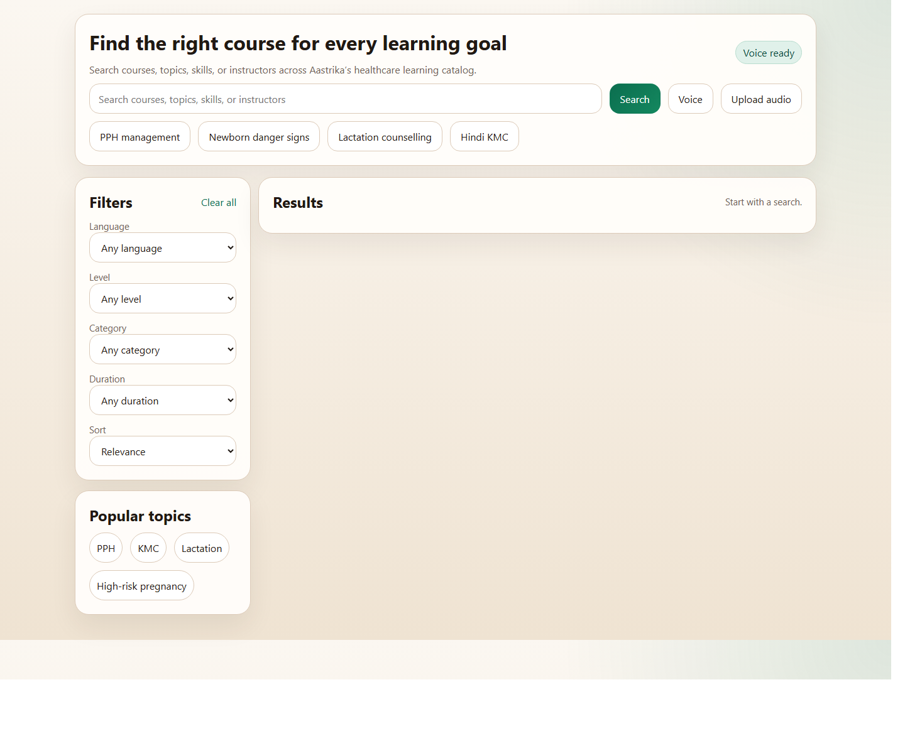
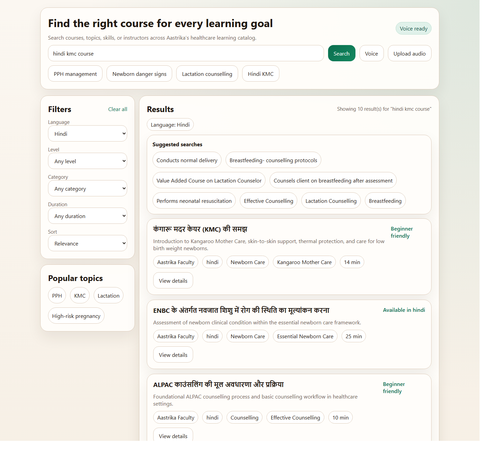

# Sphere Advanced Search integration

The current Sphere integration uses Python/FastAPI and the existing PRISM ranking pipeline. `POST /v1/search` returns original ranked course IDs and total only, with optional `corrected_query`. A query uses relevance; browse uses `lastUpdatedOn` descending with course-ID ties. Both paths apply offset and limit after filtering and ordering.

OpenSearch persists the transformed catalogue. The ranking pipeline scores the complete local snapshot loaded from that index. It is not replaced by a generic engine query. The Node UI proxy hydrates IDs through the unchanged public API and preserves ranked order. No Java or LERN change is required.

See [API contract](docs/SPHERE_API_CONTRACT.md), [runbook](docs/deployment.md), [proxy handoff](docs/PRINCE_HANDOFF.md), and [final evidence](docs/FINAL_ADVANCED_SEARCH_INTEGRATION_EVIDENCE.md). The `/api/v1/search` full-record response is the separate existing demo/debug API; it is not the Sphere integration endpoint.

The public catalogue sync was verified on 7 October 2026: 620 records across seven pages, 620 indexed, zero rejected. Incremental traversal observed 620 unchanged records and zero upserts. These are observed counts, not constants. Kong onboarding and the upstream UI proxy merge remain external actions.

# search_opt

search_opt is a general-purpose catalog search optimization service. It addresses query normalization, repair under noisy input, multilingual matching, transliteration-aware retrieval, hybrid ranking, precision control, and recovery-oriented response shaping. The backend turns irregular, high-variance search input into consistent retrieval behavior through explicit ranking logic and measurable optimization techniques.

## Present It Today: One-Command Runbook

From the repository root, run:

```powershell
powershell -ExecutionPolicy Bypass -File .\launch.ps1
```

That single file creates the virtual environment when needed, installs missing dependencies on the first run, loads the sample catalog, starts the API in the background, waits for the readiness check, writes logs, and opens the demo. It deliberately uses the deterministic in-memory backend, local semantic fallback, and mock voice adapter so a presentation does not depend on Docker, a model download, or the internet.

The URLs are:

- demo: `http://127.0.0.1:8000/demo`
- interactive API documentation: `http://127.0.0.1:8000/docs`
- readiness: `http://127.0.0.1:8000/api/v1/ready`
- runtime logs: `artifacts/runtime/search_opt.log`

Lifecycle commands:

```powershell
.\launch.ps1 status
.\launch.ps1 stop
.\launch.ps1 restart
.\launch.ps1 validate
```

Use `validate` before the meeting to run the test suite and retrieval benchmark. If PowerShell blocks scripts, use the longer `powershell -ExecutionPolicy Bypass -File ...` form. To avoid opening a browser automatically, pass `-NoBrowser`. To see server output directly, pass `-Foreground`. To demonstrate the external engine adapter, start Docker Desktop and run `./launch.ps1 -Backend opensearch`; the in-memory path is the recommended presentation path.

`launch.ps1 stop` stops the API process it started. If you opted into OpenSearch, stop that container separately with `docker compose stop opensearch` when finished.

### Five-Minute Presentation Flow

1. Start on `/demo` and describe the general retrieval problem: users search with typos, acronyms, mixed languages, transliteration, and incomplete phrases.
2. Search `postpartum hemorrhage management` to show a clean domain query and result metadata.
3. Search `postpartumhemorrhageassessment` to show missing-space recovery, then `PPHHH primary management` to show noisy-input repair. Explain that correction is threshold-controlled rather than unconditional.
4. Search `kmc samajh` or `garbhavastha hrp` to show romanized-Hindi and acronym-aware matching.
5. Type `lact` slowly to show grouped suggestions, then use the filters and result facets.
6. Open `/docs` to show that the demo is backed by a documented REST API, not hard-coded UI data.
7. Open `/api/v1/ready` and mention health/readiness probes, analytics persistence, rate limiting, structured errors, request-size limits, tests, and benchmark artifacts.
8. Close with the boundary: this is a production-conscious search service and evaluation prototype; a real rollout still needs environment onboarding, observability, secrets, load testing, and relevance evaluation on real traffic.

### Short Talk Track

> search_opt is a multilingual catalog retrieval service. Its main value is not the search box; it is the retrieval pipeline behind it. The service cleans noisy input, detects language and intent, repairs controlled classes of errors, retrieves candidates using lexical, fuzzy, phonetic, and semantic evidence, and reranks them with explicit weights. It then deduplicates related variants, estimates confidence, and returns corrections, facets, suggestions, and explanations through a FastAPI contract. The sample benchmark currently achieves 250 of 252 top-one matches, all 252 within the top three, and all 20 negative guardrail cases. The architecture is designed so OpenSearch can persist the same catalogue and load a local ranking snapshot and the mock voice adapter can be replaced by Whisper without changing the API consumer.

## Paste-Ready Brief For ChatGPT

Copy the block below into a new chat when you want help turning the project into slides, rehearsing answers, or tailoring the explanation to a particular manager:

```text
I need to present a project called search_opt, a general-purpose catalog search optimization service.

PRODUCT PROBLEM
Users do not type perfect catalog titles. They use acronyms, spelling errors, missing spaces, multiple languages, romanized text, code-mixed phrases, voice-style filler words, and incomplete descriptions. A basic substring or database search loses relevant items or ranks the wrong variant.

WHAT THE SYSTEM DOES
search_opt exposes a FastAPI REST service and a browser demo. It accepts text or voice-search requests, normalizes and interprets the query, retrieves catalog candidates, combines several relevance signals, reranks and deduplicates the candidates, and returns results plus corrections, confidence, facets, alternate searches, and grouped autocomplete suggestions. It bootstraps a representative sample catalog for the demo. Search events and correction events can be recorded in SQLite analytics.

SEARCH PIPELINE
1. Normalize Unicode, case, punctuation, repeated letters, filler words, and compact text.
2. Detect likely language, code mixing, requested difficulty, and topic hints.
3. Generate carefully thresholded repairs for token typos, whole-title errors, transliteration variants, acronyms, and queries whose spaces were removed.
4. Retrieve candidates using title and body lexical evidence, fuzzy similarity, phonetic overlap, semantic similarity, aliases, and rescue rules.
5. Rerank with a weighted hybrid formula covering BM25-style lexical score, title score, fuzzy score, semantic score, exact phrase evidence, phonetic evidence, language preference, popularity, and recency.
6. Apply confidence and minimum-score thresholds, deduplicate records by logical group so translated variants do not flood the results, and build explanations, facets, alternate queries, and suggestions.

WHY MULTIPLE ALGORITHMS ARE USED
Exact lexical evidence is precise but brittle. Fuzzy matching repairs spelling but can over-match. Phonetic similarity helps pronunciation-like errors. Transliteration connects romanized input to Indic-script records. Semantic similarity helps when wording differs. Popularity and recency are useful tie-breakers but should not overpower relevance. search_opt combines these signals with explicit weights and guardrails instead of expecting one algorithm to solve every query type.

ARCHITECTURE
The browser demo calls versioned /api/v1 endpoints. API routes validate requests and delegate to service orchestration. QueryProcessor handles normalization and repair. SearchBackend provides a replaceable retrieval boundary with in-memory and OpenSearch-backed implementations. HybridReranker combines signals. SuggestService supplies autocomplete and recovery. TranscriptionAdapter supports a deterministic mock and an optional faster-whisper implementation. AnalyticsTracker writes non-critical events to SQLite and degrades without breaking search. Health, readiness, and liveness endpoints expose dependency status.

MEASURED RESULTS
The checked-in evaluation artifact contains 252 positive queries and 20 negative precision guardrails. It reports 250/252 top-one hits (99.2%), 252/252 top-three hits (100%), and 20/20 correct no-result decisions. The cases include exact titles, acronyms, punctuation, extra spacing, removed spacing, word-order changes, Hindi script, romanized Hindi, English aliases, generated natural-language variants, and voice-style inputs. These numbers describe the sample evaluation set, not guaranteed performance on future production traffic.

ENGINEERING AND OPERATIONS
The system includes typed schemas, structured error envelopes, request IDs, API-key middleware, rate limiting, request and audio size limits, sample-data bootstrap, health/readiness/liveness probes, analytics, Docker/OpenSearch configuration, automated tests, an offline benchmark, and a one-file background launcher with PID, log, status, stop, restart, and validation commands. Startup avoids surprise network downloads; optional large models and OpenSearch are explicit choices.

HONEST MATURITY
This is a production-conscious prototype, not a claim that deployment work is finished. Before a real launch it needs a production data source, managed OpenSearch sizing and backups, secret management, TLS and gateway policy, centralized logs/metrics/traces, load and soak tests, relevance judgments from real users, privacy review for analytics/audio, CI/CD, and rollback/runbook ownership.

Please help me create a manager-friendly presentation using this information. Give me a slide-by-slide narrative, a live-demo script, likely technical and product questions with concise answers, and advice on which details to simplify for my audience.
```

## Why This Is Interesting

- It handles exact queries, noisy queries, acronym-heavy queries, missing-space queries, romanized Hindi, and code-mixed inputs inside one retrieval architecture rather than through ad hoc exceptions.
- It combines BM25-style lexical evidence, fuzzy repair, phonetic comparison, and semantic rescue behind a clean REST boundary.
- It exposes indexing, suggestions, health checks, analytics hooks, and voice-search seams inside a single end-to-end search stack.
- Sphere integration is orchestrated by the existing Node UI proxy over HTTP.

## System Character

search_opt applies a set of search optimization techniques with discipline and internal coherence:

- aggressive query cleanup before retrieval
- multiple repair paths for user-input noise
- domain-aware language and transliteration handling
- hybrid evidence accumulation instead of single-score ranking
- rescue logic for difficult queries
- measurable evaluation instead of anecdotal demos

That combination gives the system strong retrieval depth, strong explainability, and strong practical value.

## Sample Catalog Profile

The sample corpus is deliberately rich in the kinds of variation that make search difficult. It contains domain-specific titles, short labels, aliases, translated variants, categories, contributors, and descriptive metadata. The subject matter is sample data; the retrieval architecture itself is domain-neutral.

The names themselves are noisy and diverse in exactly the way real search traffic tends to be noisy and diverse:

- full descriptive titles and short labels coexist
- acronyms appear alongside expanded forms
- Hindi script, English titles, and romanized Hindi variants appear in the same search universe
- topic phrasing varies across formal terms, competency names, and user-facing item names
- spacing, punctuation, casing, transliteration, and word-order variation all matter materially to retrieval quality

That data profile creates a realistic optimization problem: ranking quality depends on how well the system reconciles lexical precision, language variation, phonetic closeness, and semantic intent.

## Retrieval Pipeline

1. Normalize the query: Unicode cleanup, casing normalization, punctuation removal, repeated-letter reduction, filler-word stripping, and compact-text handling.
2. Repair the query: token-level typo correction, title-level fuzzy repair, compact-title recovery for missing spaces, and transliteration expansion.
3. Infer intent: language preference, difficulty, topical hints, code-mixed detection, and a compressed query summary for downstream retrieval.
4. Retrieve candidates: title/body BM25-style scoring, fuzzy similarity, phonetic overlap, semantic similarity, and rescue behavior that expands recall without sacrificing ranking quality.
5. Rerank results: weighted hybrid scoring with phrase overrides, language preference boosts, popularity and recency hooks, and confidence estimation.
6. Enrich the response: explanations, grouped variants, facets, alternate queries, and guided recovery suggestions.

This is implemented primarily in [app/search/query_processor.py](app/search/query_processor.py), [app/search/backend.py](app/search/backend.py), and [app/services/search_service.py](app/services/search_service.py).

## Algorithms And Optimisation Ideas

- Aastrika PRISM Rank is the named flagship ranking algorithm. It combines BM25-style lexical evidence, title evidence, fuzzy and phonetic recovery, semantic similarity, structured attribute matching, contextual learning intent, metadata quality, popularity, recency, and explicit penalties for conflicting requested attributes. See [docs/aastrika_prism_rank.md](docs/aastrika_prism_rank.md).
- BM25-style lexical scoring is computed separately over title terms and broader course text so exact thematic evidence remains prominent across the ranking stack.
- Token-level and whole-query fuzzy repair use explicit confidence thresholds, which keeps autocorrection precise and controlled.
- Compact-query segmentation and no-space recovery allow collapsed inputs to be reconstructed into meaningful search terms.
- Indic transliteration expansion allows romanized queries to recover Hindi catalog items without forcing the user to match the script of the indexed content.
- Phonetic rescue uses Soundex-style overlap to recover plausible matches when spelling quality is poor but pronunciation remains informative.
- Semantic similarity acts as a retrieval and rescue signal, while a local weighted-token fallback preserves functionality when the transformer model is unavailable.
- Weighted reranking combines lexical, fuzzy, phrase, semantic, phonetic, popularity, recency, and language-preference signals into a single score rather than privileging any one technique absolutely.
- Confidence estimation and rescue thresholds control when imperfect but defensible matches should surface, which is an optimisation problem in itself rather than a simple ranking afterthought.
- Deduplication by logical item group prevents multilingual variants from flooding the top of the result set and preserves result diversity.
- Faceting, alternate queries, grouped suggestions, and recovery guidance extend the optimisation work beyond raw ranking into retrieval usability.

Taken together, these choices make search_opt a practical search optimization system for noisy, multilingual, partially transliterated, and domain-specific input.

## Benchmark Snapshot

From [`artifacts/benchmark_report.json`](artifacts/benchmark_report.json):

- `top1`: `250 / 252` -> `99.2%`
- `top3`: `252 / 252` -> `100%`
- precision guardrail set: `20 / 20` -> `100%`

The evaluation set includes exact-title, acronym, typo, no-space, romanized Hindi, Hindi-script, code-mixed, voice-style, and other generated NLP variants. Those results reflect a retrieval system that is tuned for real user behavior rather than idealized query text.

Current local test run:

- Historical demo checkpoint: `27 passed, 1 skipped`; see final evidence for the current infrastructure-enabled acceptance run.

The benchmark covers the cases that usually separate average search from excellent search: acronyms, spacing noise, transliterated inputs, query reformulation, voice-style prompts, and precision guardrails under ambiguous traffic.

## Demo UI

The repo includes an interactive search console at `/demo`. It showcases retrieval behavior, result shaping, guided reformulation, and UI-level inspection of the ranking flow.






Screenshots can be regenerated locally with [`scripts/capture_demo_screenshots.ps1`](scripts/capture_demo_screenshots.ps1).

## Manual Quick Start

```powershell
python -m venv .venv
.\.venv\Scripts\activate
pip install -r requirements.txt
powershell -ExecutionPolicy Bypass -File .\scripts\run_local.ps1
```

Local endpoints:

- API root: `http://localhost:8000`
- Swagger UI: `http://localhost:8000/docs`
- Demo UI: `http://localhost:8000/demo`
- Debug UI: `http://localhost:8000/demo/debug`

The default local path uses the in-memory backend and loads [`sample_data/courses.json`](sample_data/courses.json).

## API Surface

- `POST /api/v1/search`
- `GET /api/v1/suggest`
- `POST /api/v1/search/voice`
- `POST /api/v1/index/bulk`
- `POST /api/v1/index/update`
- `POST /api/v1/index/delete`
- `POST /api/v1/index/reindex`
- `GET /api/v1/health`
- `GET /api/v1/ready`
- `GET /api/v1/live`

The API contract is documented in [docs/api_contract.md](docs/api_contract.md).

## Technical Notes

- Default backend: in-memory search backend behind a `SearchBackend` abstraction.
- OpenSearch backend path: persistent Sphere catalogue and local ranking snapshot, validated through Docker.
- Semantic path: sentence-transformers when available, with local fallback behavior.
- Voice path: mock STT by default, `faster-whisper` integration seam available.
- Operational controls: auth middleware, rate limiting, structured error envelopes, analytics logging.

The implementation demonstrates strong retrieval depth, clear architectural layering, and production-conscious backend design.

## Production Readiness: What Exists And What Remains

Already implemented are versioned APIs, typed validation, structured failures, API-key and rate-limit controls, request-size limits, health probes, analytics isolation, pluggable retrieval and transcription adapters, automated tests, benchmark reporting, Docker configuration, deterministic fallback behavior, and managed local startup.

The real public course source is now connected by the sync command. Before live production use, deploy a managed and monitored search cluster; store secrets outside environment files; put TLS, gateway policy, and distributed rate limiting at the edge; add centralized metrics, logs, traces, alerting, backups, and disaster recovery; run load, soak, security, and privacy testing; and continuously evaluate relevance with anonymized real queries and human judgments. The current benchmark is strong evidence for the checked-in corpus and test set, not a guarantee about unseen production traffic.

## Project Layout

- `app/api/` REST routes and request wiring
- `app/search/` normalization, repair, retrieval, encoding
- `app/ranking/` hybrid scoring and confidence
- `app/suggest/` grouped autocomplete suggestions
- `app/voice/` speech-to-text adapter seam
- `app/services/` orchestration and response assembly
- `tests/` search, indexing, normalization, failure-mode, suggestion, and integration tests
- `docs/` architecture, deployment, API, evaluation, and Sphere integration notes

## OpenSearch Validation

```powershell
powershell -ExecutionPolicy Bypass -File .\scripts\start_opensearch.ps1
python .\scripts\opensearch_smoke_test.py
powershell -ExecutionPolicy Bypass -File .\scripts\stop_opensearch.ps1
```

The OpenSearch path allows the same search concepts to be exercised against an external engine-backed deployment flow.

## Additional Documentation

- [docs/aastrika_prism_rank.md](docs/aastrika_prism_rank.md)
- [docs/presentation_briefing.md](docs/presentation_briefing.md)
- [docs/architecture.md](docs/architecture.md)
- [docs/search_pipeline.md](docs/search_pipeline.md)
- [docs/testing_and_evaluation.md](docs/testing_and_evaluation.md)
- [docs/java_integration.md](docs/java_integration.md)
- [docs/current_status.md](docs/current_status.md)
